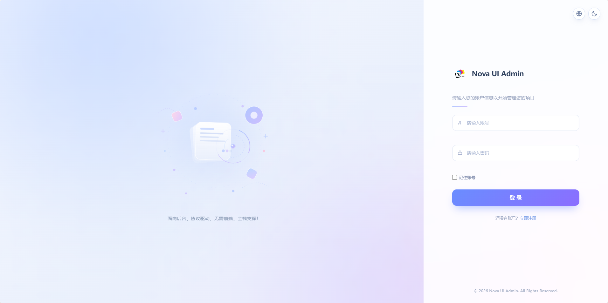
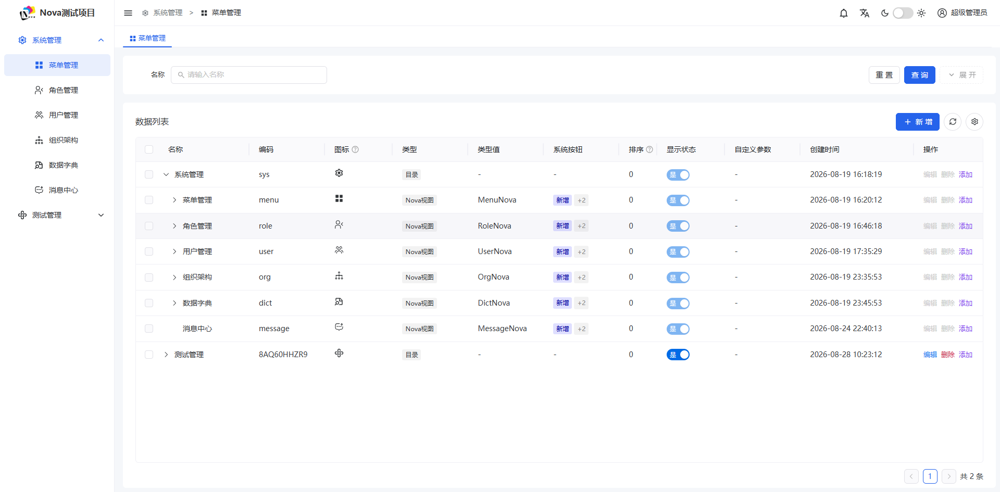
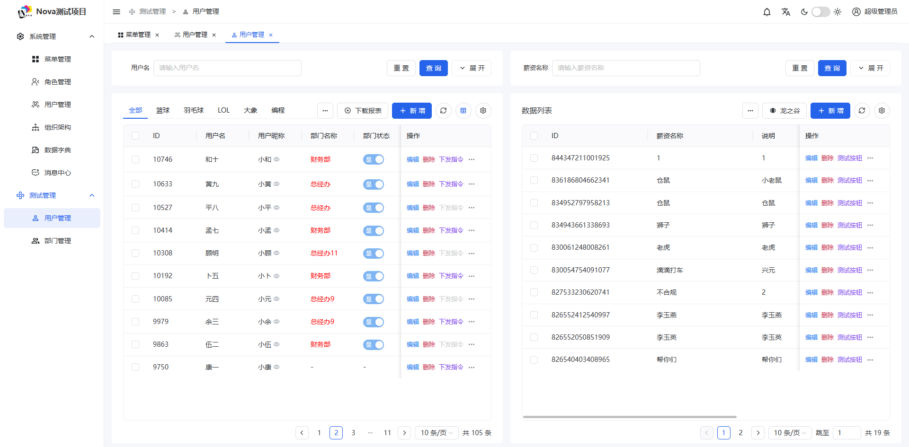
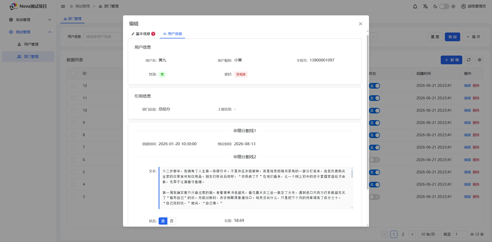

<h1 align="center">🚀 Nova</h1>

<p align="center">
  <strong>注解驱动的全栈后台协议框架 · JDK 21 · Spring Boot 3.3.4 · Naive UI</strong>
</p>

<p align="center">
  <em>你写的不是页面，是页面的元数据。</em>
</p>

<p align="center">
  📖 <a href="https://www.yuque.com/laoshiren-bne7g/nova"><strong>使用文档</strong></a>
  &nbsp;·&nbsp;
  🧪 <a href="http://182.43.87.39:8989"><strong>在线体验</strong></a>
  &nbsp;·&nbsp;
  🔑 演示账号：<code>show / 123456</code>
</p>

<p align="center">
  <a href="https://www.yuque.com/laoshiren-bne7g/nova"></a>
  <a href="http://182.43.87.39:8989"></a>
  <a href="LICENSE"></a>
  
  
</p>

---

## ✨ 简介

Nova 是一款基于注解驱动的后台协议框架。**你写注解，它出界面**：开发者只需用 Java 注解描述数据与视图，Nova 在运行期编译为前端渲染协议（JSON），由 Naive UI 实时解析，直接渲染出完整的增删改查管理界面，全程无需编写前端代码。

### 核心理念

> **后端定义视图，前端只负责渲染。**

❌ **不绑定数据源**（MyBatis、MyBatis-Plus、JPA 等皆可接入）  
❌ **不生成代码文件**（运行期动态解析）  
❌ **不提供 CRUD 模板**（一切皆协议）

### 它解决什么问题

传统低代码框架要么**绑定数据源**（无法支撑商业级业务），要么**纯代码生成器**（简单的用不上、复杂的做不了）。Nova 选择另一条路：

- **只描述协议，不碰数据** —— 数据来源可以是 MySQL、Redis、ES、甚至 HTTP 请求等，自由组合，数据操作完全由开发者自行管理
- **运行期解析，零代码生成** —— 改注解即改页面，没有生成物需要维护
- **内置覆盖常规，逃逸口覆盖复杂** —— 复杂页面通过 TPL / Custom JS 无缝接入
- **微服务下关联组件依然可用** —— 跨服务引用/附属/多对多组件照常声明，不因服务拆分退化成手填 ID
- **AI 融入协议，而非外挂** —— 字段级 AI 审查、自然语言搜索深度融合框架，不另开对话框，用户无感
- **一人全栈交付** —— 常规页面由 Nova 注解生成，复杂页面用 Nova TPL 承载，TPL 开发可借助 AI 编写，后端一人即可完成从数据到界面的全链路

> 一句话：**传统框架替你管数据，Nova 只替你管协议**——数据复杂度留给你，页面重复劳动交给框架。
---

## 🧩 核心特性

| 特性 | 描述 |
|:---|:---|
| 🧬 **现代技术底座** | JDK 21 + Spring Boot 3.x + Naive UI |
| 📡 **视图全协议驱动** | 后端注解定义界面元素，全程 0 前端代码参与绑定 |
| 🧩 **多形态布局** | 表格、树形、左右双表、Tab 页签等复杂布局 |
| 🔐 **后端权限管控** | 菜单、操作按钮、字段级权限均由后端统一裁剪 |
| 🔗 **上下文联动** | 主从数据联动、交互状态传递与穿透 |
| 🚪 **灵活可扩展** | Custom View (Tpl) 与 Custom JS，无缝接入自定义逻辑 |
| 🌐 **微服务适配** | 一主 N 从架构，跨服务引用 / 附属 / 多对多组件照常声明，不因服务拆分退化任何功能 |
| 🤖 **AI 深度融入** | 字段级 AI 审查、自然语言搜索深度融合框架，不另开对话框，用户无感 |

---

## 📦 注解预览

```java
@Data
@Accessors(chain = true)
@Nova(
        name = "用户管理"
)
public class UserNova {

    @NovaId
    @NovaField(
            views = @View(title = "ID"),
            edit = @Edit(title = "ID", show = false)
    )
    private String id;

    @NovaField(
            views = @View(title = "用户名"),
            edit = @Edit(title = "用户名", notNull = true, search = @Search)
    )
    private String name;

    @NovaField(
            views = @View(title = "性别"),
            edit = @Edit(
                    title = "性别",
                    type = Edit.Type.CHOICE,
                    choiceType = @ChoiceType(
                            vl = {
                                    @VL(value = "1", label = "男", color = "#28f439"),
                                    @VL(value = "2", label = "女", color = "#fe6767")
                            }
                    ),
                    notNull = true
            )
    )
    private Integer sex;

    @NovaField(
            views = @View(title = "技术栈"),
            edit = @Edit(
                    title = "技术栈",
                    type = Edit.Type.CHOICE,
                    choiceType = @ChoiceType(
                            selectType = ChoiceType.SelectType.MULTI,
                            vl = {
                                    @VL(value = "Java", label = "Java"),
                                    @VL(value = "Python", label = "Python"),
                                    @VL(value = "Go", label = "Golang")
                            }
                    )
            )
    )
    private String skill;
}
```

## 🖥️ 页面预览
<p align="center">
  
  
</p>
<p align="center">
  
  
</p>


## 📄 许可证

Nova 采用 [Apache License 2.0](LICENSE) 开源协议。
